<div align="center">

# 🛍️ DormDeal | Your Dorm. Your Deals.
### **University-Exclusive Peer-to-Peer Student Marketplace & Rental Hub**

[](https://nodejs.org/)
[](https://expressjs.com/)
[](https://react.dev/)
[](https://vitejs.dev/)
[](https://tailwindcss.com/)
[](https://www.mongodb.com/)
[](https://www.postgresql.org/)
[]()

<br />

**A campus-contained circular economy platform connecting verified university students across hostel blocks for direct buying, selling, short-term renting, and reverse broadcast requests with 1-click WhatsApp physical handovers.**

[Explore Live Demo](#-quick-start) • [System Architecture](#-system-architecture) • [Team Contributions](#-team-work-division) • [DBMS Documentation](#-database--dbms-architecture) • [API Reference](#-api-endpoints-reference)

---

</div>

## 📌 Table of Contents
1. [Platform Highlights](#-platform-highlights)
2. [Dual Marketplace Engine (BUY & RENT)](#-dual-marketplace-engine)
3. [Reverse Marketplace (ISO Broadcast Board)](#-reverse-marketplace-iso-board)
4. [Handover Contract State Machine](#-handover-contract-lifecycle)
5. [Campus Taxonomy (11 Categories)](#-11-core-campus-categories)
6. [Team Responsibility Division](#-team-work-division)
7. [Database & DBMS Architecture](#-database--dbms-architecture)
8. [Technology Stack](#-technology-stack)
9. [API Endpoints Reference](#-api-endpoints-reference)
10. [Quick Start & Setup](#-quick-start)
11. [Real OTP Configuration (Email & SMS)](#-real-otp-configuration)
12. [Verification & Test Suite](#-automated-test-suite)

---

## 🌟 Platform Highlights

DormDeal is engineered to eliminate fraudulent third-party listings, eliminate shipping delays, and remove platform commission fees:

- 🏫 **100% University Verified**: Requires active university enrollment IDs, student emails, hostel block, and room numbers.
- 🤝 **Direct Offline Handover (No Platform Fees)**: Transactions finalize in-person via cash or UPI upon physical inspection.
- ⚡ **1-Click WhatsApp Quick-Chat**: Pre-formats `https://wa.me/<phone>?text=<encoded_text>` quoting the exact item, price, and hostel meetup request with zero contact saving friction.
- 📍 **"In Your Hostel!" Proximity Badges**: Dynamically identifies whether a seller lives on your floor or block.
- ⏱️ **Auto-Expiry Engines**: 14-day auto-TTL for marketplace listings and 3-day (72-hour) auto-TTL for urgent student broadcast requests.
- 🔄 **1-Click Relisting / Renew**: One-click listing extension (`+14 days`) so items stay fresh without stale clutter.
- 🛡️ **Mandatory Defect Disclosure**: Enforces explicit condition explanations (`defectDetails`) if an item has scratches, tears, or defects.
- 🔒 **Security Deposit Escrow Tracking**: Calculates and protects refundable deposits for short-term tool, camera, and blazer rentals.
- 🌟 **Verified Deal Reviews**: Strictly 1 review per completed handover, dynamically updating seller trust ratings (1.00 to 5.00).

---

## 🔁 Dual Marketplace Engine

Students can toggle between direct sales and short-term rentals within a unified interface:

```
+-----------------------------------------------------------------------------------------+
|                                    LISTING MODES                                        |
+-----------------------------------------------------------------------------------------+
|  DIRECT SALE MODE (BUY)                     |  SHORT-TERM RENTAL HUB (RENT)             |
+---------------------------------------------+-------------------------------------------+
|  • Permanent ownership transfer             |  • Period-based pricing: hour/day/wk/mo   |
|  • Fixed Price or Bargaining Toggle         |  • Mandatory Refundable Security Deposit  |
|  • MRP Discount Savings Display             |  • Escrow return status inspection        |
|  • 3-Photo visual inspection gallery        |  • Automatic return-to-inventory state    |
|  • 14-day auto-expiry lifespan              |  • Date-range active rental tracking      |
+-----------------------------------------------------------------------------------------+
```

---

## 📢 Reverse Marketplace (ISO Board)

Instead of searching endlessly, students who need an item urgently for an exam, project, or event can broadcast an **"In Search Of" (ISO)** request:

1. **Broadcast Creation**: Student posts item needed (*e.g., "Casio 991CW Calculator for tomorrow's exam"*), category, budget (₹), and urgency (*Urgent / Today / Flexible*).
2. **72-Hour Live Countdown**: Every card displays hours remaining before auto-expiry.
3. **1-Click "I Have This!" Fulfillment**: Any campus peer with the item clicks one button to fulfill the request.
4. **Instant In-App Alert**: The requester immediately receives a high-priority notification with the fulfilling student's hostel block, room number, and phone number to coordinate pickup.

---

## 🔄 Handover Contract Lifecycle

DormDeal formalizes transactions through an enforceable state machine rather than unmanaged chats:

```mermaid
stateDiagram-v2
    [*] --> PENDING: Buyer requests deal
    PENDING --> ACCEPTED: Seller approves & sets hostel meetup
    PENDING --> CANCELLED: Deal rejected
    ACCEPTED --> ACTIVE: Physical inspection complete; cash/UPI paid
    ACCEPTED --> CANCELLED: Handover aborted
    ACTIVE --> RETURNED: (Rental) Item returned & deposit released
    ACTIVE --> COMPLETED: (Direct Sale) Handover finalized
    RETURNED --> COMPLETED: Handover finalized
    COMPLETED --> [*]: Verified 1-to-5 Star Review Unlocked
```



---

## 📦 11 Core Campus Categories

DormDeal's taxonomy is tailored specifically to university dormitory life:

| Category | Example Student Items |
| :--- | :--- |
| **👔 Clothing** | Placement suits & blazers, winter hoodies, ethnic fest formals, college jerseys |
| **⚡ Electronics** | Scientific calculators (Casio 991EX), extension spikes, kettles, room coolers, DSLR cameras |
| **📝 Notes** | Handwritten spiral notebooks, semester question banks, exam cheat-sheets |
| **🖨️ Printouts** | Lab observation manuals, syllabus packets, architecture blueprints |
| **🍫 Groceries** | Hostel midnight snacks, packaged dry foods, instant noodles, beverages |
| **📐 Stationery** | Engineering drafters, sheet containers, geometry compass sets, acrylic markers |
| **🪑 Hostel Decor** | Study desk chairs, foldable bed tables, fairy lights, organizers, laundry hampers |
| **🍳 Utensils** | Induction cookware, stainless steel plates, mugs, spoons, electric kettles |
| **🧴 Skincare** | Daily grooming essentials, sunscreens, personal care bottles |
| **💇 Haircare** | Hair dryers, ceramic straighteners, hair clippers, styling brushes |
| **🏸 Sports Items** | Badminton racquets, shuttlecocks, gym dumbbells, bicycles, yoga mats |

---

## 👥 Team Work Division

The system workload was split according to technical domains and module complexity. For full details, see **[PROJECT_TEAM_DIVISION.md](file:///Users/swastikmishra1425/Desktop/DormDeal/DormDeal_AP_2026/PROJECT_TEAM_DIVISION.md)**.

```
                      DORMDEAL RESPONSIBILITY MATRIX
  =======================================================================
  
  [ FRONTEND ARCHITECTURE ]
  ├─ Marketplace Catalog & Detail Modals ─────── Kunal
  ├─ Dual Sell/Rent Listing Form ─────────────── Kunal
  ├─ Category Filter & Search Bar ────────────── Kunal
  │
  ├─ Reverse Marketplace ISO Board ───────────── Abhijeet
  ├─ Deals Handover Contract Manager ─────────── Abhijeet
  ├─ Post-Handover 1-5 Star Reviews ──────────── Abhijeet
  └─ Live Notifications Polling Hook ─────────── Abhijeet

  [ BACKEND ARCHITECTURE (~80% Core) ]
  ├─ Auth, JWT, OTP & Security Middleware ────── Swastik (Lead)
  ├─ Handover Deals State Machine ────────────── Swastik (Lead)
  ├─ Auto-Expiry Engine (14d/3d TTL) ─────────── Swastik (Lead)
  ├─ Reverse Broadcast Matchmaking Engine ────── Swastik (Lead)
  ├─ Multer Multi-Photo Pipeline ─────────────── Swastik (Lead)
  │
  ├─ Items Catalog Read & Search APIs ────────── Kunal (Simple API)
  ├─ Reviews & Notifications APIs ────────────── Abhijeet (Simple API)
  └─ Health Ping & DB Connection Handler ─────── Tanishka (Simple API)

  [ DATABASE & DBMS ARCHITECTURE ]
  ├─ 3NF/BCNF Relational SQL Schema ──────────── Tanishka
  ├─ ER Diagram & Normalization Proofs ───────── Tanishka
  ├─ Workload & Analytical SQL Queries ───────── Tanishka
  ├─ Mongoose Schemas & DB Seeder ────────────── Tanishka
  └─ DBMS Architecture Documentation ────────── Tanishka
  =======================================================================
```

---

## 🗄️ Database & DBMS Architecture

DormDeal implements a dual data architecture: **PostgreSQL Relational 3NF Schema** for formal DBMS documentation and **MongoDB/Mongoose Document Collections** for flexible application persistence.

### Entity Relationship Diagram
```
+-----------------------------------------------------------------------------------------------------------------+
|                                           ENTITY RELATIONSHIP OVERVIEW                                          |
+-----------------------------------------------------------------------------------------------------------------+
|                                                                                                                 |
|   +-----------------------+              +-----------------------+              +---------------------------+   |
|   |         USERS         |              |      CATEGORIES       |              |    BROADCAST_REQUESTS     |   |
|   +-----------------------+              +-----------------------+              +---------------------------+   |
|   | PK  user_id           |              | PK  category_id       |              | PK  broadcast_id          |   |
|   |     enrollment_id (UQ)|              |     category_name (UQ)| <------+     | FK  buyer_id      (USERS) |   |
|   |     email         (UQ)|              |     slug          (UQ)|        |     | FK  category_id (CATEGOR) |   |
|   |     hostel_name       |              +-----------+-----------+        |     |     title, budget, notes  |   |
|   |     room_number       |                          |                    |     |     status, expires_at    |   |
|   |     avg_rating        |                          | 1:N                |     +---------------------------+   |
|   +-----------+-----------+                          |                    |                                     |
|               |                                      |                    |                                     |
|               +-----------------------+              |                    |                                     |
|               | 1:N (as seller)       | 1:N          v                    |                                     |
|               v                       v     +--------+------------+       |                                     |
|   +-----------+-----------+   +-------+---+ |        ITEMS        |       |                                     |
|   |     NOTIFICATIONS     |   |  REVIEWS  | +---------------------+       |                                     |
|   +-----------------------+   +-----------+ | PK  item_id         |       |                                     |
|   | PK  notification_id   |   | review_id | | FK  seller_id       |-------+                                     |
|   | FK  recipient_id      |   | FK deal_id| | FK  category_id     |                                             |
|   |     title, message    |   | rating    | |     listing_type    | ('SELL' | 'RENT')                           |
|   +-----------------------+   +-----+-----+ |     price, deposit  |                                             |
|                                     |       |     has_defects     |                                             |
|                                     | 1:1   |     expires_at (14d)|                                             |
|                                     v       +----------+----------+                                             |
|                               +-----+-------+          |                                                        |
|                               |    DEALS    |          | 1:N                                                    |
|                               +-------------+          v                                                        |
|                               | PK deal_id  |   +------+------+                                                 |
|                               | FK item_id  |   | ITEM_IMAGES |                                                 |
|                               | FK buyer_id |   +-------------+                                                 |
|                               | FK seller_id|   | PK image_id |                                                 |
|                               +-------------+   +-------------+                                                 |
+-----------------------------------------------------------------------------------------------------------------+
```

### DBMS Artifacts in `/dbms`:
- **`dbms/01_normalization.md`**: Academic proofs eliminating insertion, update, and deletion anomalies through 1NF, 2NF, 3NF, and BCNF.
- **`dbms/02_er_diagram.svg`**: High-resolution vector Entity-Relationship diagram.
- **`dbms/03_schema.sql`**: Production PostgreSQL DDL with check constraints and foreign keys.
- **`dbms/04_queries.sql`**: Workload queries covering seller ratings, active rental deposit audits, and auto-expiry cron cleanups.
- **`dbms/DATABASE_DOCUMENTATION.md`**: Complete report on transaction isolation, indexing, and normalization.

---

## 💻 Technology Stack

### Backend
- **Runtime**: Node.js (v18+) with Express.js REST API.
- **Data Modeling**: Mongoose 8.x + MongoDB.
- **In-Memory Fallback**: `mongodb-memory-server` (spins up automatically if local MongoDB is offline).
- **Authentication**: Stateless JWT (`jsonwebtoken`) + Salted bcrypt hashing (`bcryptjs`).
- **File Storage**: Multer multi-part handler with 5MB validation.
- **Security**: Helmet security headers, CORS origin isolation, input sanitization.
- **Notifications & Mail**: Nodemailer SMTP (Gmail, Outlook, custom) + Fast2SMS / Twilio.

### Frontend
- **Framework**: React 18 with Vite 6.
- **Styling**: Tailwind CSS with custom Neo-Brutalist design tokens (`#1c1c1d`, `#FFFDF8`, `#FFF9EE`).
- **Icons**: Lucide React.
- **Routing**: React Router DOM (v6) with declarative `ProtectedRoute` guards.
- **HTTP Client**: Axios with automatic JWT Bearer token injection.

---

## 📡 API Endpoints Reference

### 🔐 Authentication & Student Identity
| Method | Route | Access | Description |
| :--- | :--- | :--- | :--- |
| `POST` | `/api/auth/send-otp` | Public | Dispatches 6-digit verification OTP (Email / SMS) |
| `POST` | `/api/auth/verify-otp` | Public | Validates 6-digit OTP code |
| `POST` | `/api/auth/register` | Public | Registers student with hostel block & room |
| `POST` | `/api/auth/login` | Public | Authenticates via email/phone and issues JWT |
| `POST` | `/api/auth/reset-password` | Public | Resets password using verified OTP |
| `PUT` | `/api/users/accept-disclaimer` | Private | Accepts campus trading guidelines |
| `GET` | `/api/users/me` | Private | Retrieves current authenticated student profile |

### 🛍️ Marketplace Catalog (BUY & RENT)
| Method | Route | Access | Description |
| :--- | :--- | :--- | :--- |
| `GET` | `/api/items` | Public | Lists active items with category, search, and type filters |
| `GET` | `/api/items/:id` | Public | Fetches item details with seller hostel info |
| `POST` | `/api/items` | Private | Creates new listing with multi-image upload |
| `PUT` | `/api/items/:id/status` | Private | Updates status (`AVAILABLE`, `RENTED`, `SOLD`) |
| `PUT` | `/api/items/:id/renew` | Private | Extends listing lifespan by +14 days |
| `DELETE` | `/api/items/:id` | Private | Deletes listing (owner only) |

### 📢 Reverse Marketplace (ISO Broadcasts)
| Method | Route | Access | Description |
| :--- | :--- | :--- | :--- |
| `GET` | `/api/broadcasts` | Public | Lists active broadcasts (3-day countdown) |
| `POST` | `/api/broadcasts` | Private | Creates an urgent item request |
| `POST` | `/api/broadcasts/:id/match` | Private | "I Have This!" fulfill action; alerts buyer |

### 🤝 Deals & Contract Handover
| Method | Route | Access | Description |
| :--- | :--- | :--- | :--- |
| `POST` | `/api/deals` | Private | Initiates purchase or rental deal contract |
| `GET` | `/api/deals/my-deals` | Private | Fetches active and completed student deals |
| `PUT` | `/api/deals/:id/status` | Private | Advances state machine (`ACCEPTED`, `ACTIVE`, `RETURNED`, `COMPLETED`, `CANCELLED`) |

### ⭐ Reviews & Notifications
| Method | Route | Access | Description |
| :--- | :--- | :--- | :--- |
| `POST` | `/api/reviews` | Private | Submits 1-5 star review for completed deal |
| `GET` | `/api/reviews/seller/:sellerId` | Public | Retrieves verified reviews for a student |
| `GET` | `/api/notifications` | Private | Retrieves in-app alerts (30s polling) |
| `PUT` | `/api/notifications/:id/read` | Private | Marks alert as read |

---

## 🚀 Quick Start

### 1. Clone & Install Dependencies
```bash
git clone https://github.com/swastikmishra1425/DormDeal.git
cd DormDeal/DormDeal_AP_2026

# Install backend dependencies
cd backend && npm install

# Install frontend dependencies
cd ../frontend && npm install
```

### 2. Configure Environment Variables
Inside `DormDeal_AP_2026/backend/.env`:
```env
PORT=5001
NODE_ENV=development
MONGO_URI=mongodb://127.0.0.1:27017/dormdeal
JWT_SECRET=dormdeal_campus_jwt_secret_key_2026
JWT_EXPIRE=30d
CLIENT_URL=http://localhost:5173
```
> 💡 *Note: If local MongoDB is not running, DormDeal automatically launches an embedded In-Memory MongoDB instance and auto-seeds test accounts out-of-the-box!*

### 3. Start Development Servers
From the root directory:
```bash
npm run dev
```
Or run each service independently:
```bash
# Terminal 1: Backend API (:5001)
cd DormDeal_AP_2026/backend && npm start

# Terminal 2: Frontend Client (:5173)
cd DormDeal_AP_2026/frontend && npm run dev
```

### 4. Default Seed Student Credentials
| Identifier | Password | Hostel Block & Room | Role |
| :--- | :--- | :--- | :--- |
| `aarav.sharma@university.edu` | `Password@123` | Block B, Room 304 | Senior Student Seller |
| `priya.patel@university.edu` | `Password@123` | Block A, Room 108 | Student Renter |

---

## 📧 Real OTP Configuration

DormDeal supports sending actual verification OTPs to students' real email addresses and mobile phones:

### Email Delivery (Gmail Free App Password)
1. Visit [Google App Passwords](https://myaccount.google.com/apppasswords).
2. Generate an App Password for **DormDeal** (16 characters).
3. In `backend/.env`, uncomment and fill:
   ```env
   SMTP_HOST=smtp.gmail.com
   SMTP_PORT=587
   SMTP_USER=your_email@gmail.com
   SMTP_PASS=your_16_char_app_password
   EMAIL_FROM_NAME="DormDeal Campus Marketplace"
   ```

### SMS Delivery (Indian +91 Numbers)
1. Sign up at [Fast2SMS](https://www.fast2sms.com) (free test credits included).
2. In `backend/.env`, set:
   ```env
   FAST2SMS_API_KEY=your_fast2sms_api_key_here
   ```
*(When credentials are configured, the demo OTP hint turns off automatically and sends directly to your actual inbox or phone).*

---

## 🧪 Automated Test Suite

Run the full end-to-end integration and unit test suite:
```bash
cd DormDeal_AP_2026/backend
npm test
```

### Output:
```
====================================================
 STARTING DORMDEAL COMPLETE BACKEND API TEST SUITE
====================================================
[PASS] 1. GET /api/health returns healthy status
[PASS] 2. GET /api/items returns marketplace items (count: 11)
[PASS] 3. GET /api/items?type=RENT filters campus rental items
[PASS] 4. GET /api/items?search=calculator searches across titles and descriptions
[PASS] 5. GET /api/items/:id returns item with seller hostel and room details
[PASS] 6. POST /api/auth/login succeeds for student Aarav Sharma
[PASS] 7. GET /api/users/me returns authenticated student with hostel & room
[PASS] 8. POST /api/auth/send-otp generates 6-digit OTP
[PASS] 9. POST /api/auth/verify-otp verifies 6-digit code
[PASS] 10. POST /api/auth/register registers student with hostel details
[PASS] 11. POST /api/items blocks unaccepted disclaimer with 403 Forbidden
[PASS] 12. PUT /api/users/accept-disclaimer accepts guidelines
[PASS] 13. POST /api/items creates RENT listing with security deposit and defect disclosure
[PASS] 14. PUT /api/items/:id/status updates status to RENTED
[PASS] 15. PUT /api/items/:id/renew re-lists for 14 days
[PASS] 16. POST /api/broadcasts creates campus broadcast request (3-Day TTL)
[PASS] 17. POST /api/broadcasts/:id/match matches broadcast and creates notification for buyer
[PASS] 18. GET /api/notifications retrieves match alert with fulfilling student hostel & phone
====================================================
 TEST SUMMARY: 18 PASSED, 0 FAILED
====================================================
```

---

<div align="center">

**DormDeal &bull; Advanced Programming & DBMS Course Project &bull; Rishihood University**  
*Built with ❤️ by Swastik (Lead), Kunal, Abhijeet, and Tanishka*

</div>
